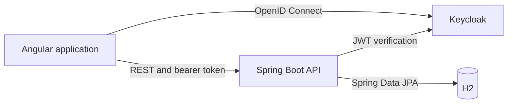

# Academic Exemption Management

ISFCE academic project for requesting exemptions based on previously completed coursework. Students can reopen a draft, link prior courses to teaching units, attach supporting documents, validate a dossier, and submit it for review.

## What the application covers

- Browse teaching units by program section and open or resume a dossier.
- Record completed courses and link them to teaching unit requests.
- Look up known equivalences and synchronize them with a draft.
- Upload supporting documents or add references to them.
- Review validation feedback, submit or resubmit, and follow dossier status.



The Spring Boot backend enforces the dossier rules and stores links and document metadata in a relational model. Uploaded files are stored on disk. The included screenshots, data model and walkthrough are available in the [project case study](https://github.com/safouanfr-arch/portfolio-isfce/tree/main/exemptions). The [PlantUML sources](dossier_analyse_diagrammes/) describe the student workflows.

## Run locally

Requirements are Java 21, Node.js 24 with npm, and a local Keycloak server for browser sign-in.

The reproducible Keycloak setup includes the sample accounts, PKCE and the API audience mapper. Existing realms should apply the equivalent settings before using the API. [Keycloak demo configuration](keycloak/README.md)

1. Run Keycloak at `http://localhost:8084`. Create a realm named `DISP` and a public OpenID Connect client named `etu-app`. Enable the standard flow and authorize `http://localhost:4200/*` as a redirect URI and `http://localhost:4200` as a web origin.
2. Create a realm role named `ETUDIANT` and assign it to a demo account named `et1`. Set fictional given and family names and an email so Keycloak emits the corresponding profile claims. The API reads the username from `preferred_username` and the student role from `realm_access.roles`.
3. Start the API and the Angular development server in separate terminals.

```sh
./gradlew bootRun
```

On Windows, use `gradlew.bat bootRun`. The API uses port `9090` and initializes the development H2 database under `data/`. Uploaded files are stored in `PID_DB/uploads/` in the user's home directory.

```sh
cd dispense_app_ang
npm ci
npm start
```

Open `http://localhost:4200`. The Angular development configuration targets the local HTTP services. `PID_ISSUER_URI` overrides the backend issuer when using a different Keycloak host or realm.

## Verify

```sh
./gradlew test
cd dispense_app_ang
npm ci
npm test -- --watch=false
npm run build
```

The component and backend test suites can run without a live Keycloak server.

The IAM review describes the sign-in flow, current permissions, document storage and proposed deployment controls. [IAM review](docs/iam-review.md)

## Academic context

This portfolio snapshot comes from Safouan Tassi's submitted ISFCE branch `safouan-processus1` at commit `b09a509`. The project extends the PID2526 course starter. This export includes source code, tests and analysis diagrams, with fictional identities in the test data and local-only development configuration.
