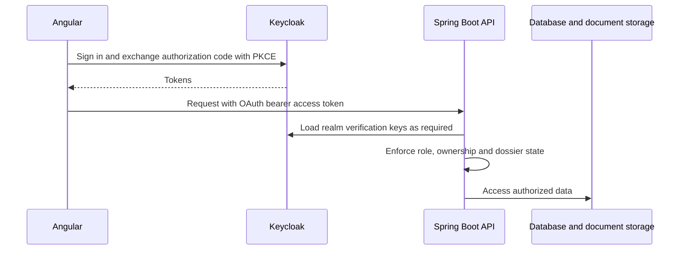

# Identity and access management

The Angular application uses a public OpenID Connect client named `etu-app` in the Keycloak realm `DISP`. The JavaScript adapter uses the authorization code flow with PKCE. It requests the `openid email` scopes, checks the Keycloak session and refreshes the access token while the user is active.

The Angular interceptor is scoped to the configured API origin. Spring Security uses a stateless bearer-token filter chain, verifies the token signature with the realm keys and maps `realm_access.roles` to authorities. The API controls which roles can read or manage the catalogue. Student endpoints also check the dossier owner, the state of the dossier and the association of linked records with their dossier. The Angular guard controls navigation. [Keycloak client](../dispense_app_ang/src/app/auth/keycloak.config.ts) · [Resource server](../src/main/java/org/isfce/pid/config/SecurityConfig.java) · [Dossier permissions](../src/main/java/org/isfce/pid/controller/DossierController.java)

The development configuration is for loopback and uses sample database records. A deployment should enforce an explicit issuer and API audience, restrict allowed browser origins, and manage uploaded documents separately from external document references.

## Verification

The workflow runs Gradle tests and the JAR build. It also installs locked npm dependencies, runs the Angular tests and compiles the frontend. These checks use test authentication and a local test data store. A browser sign-in with a configured Keycloak realm is a separate integration check. [CI workflow](../.github/workflows/ci.yml)
