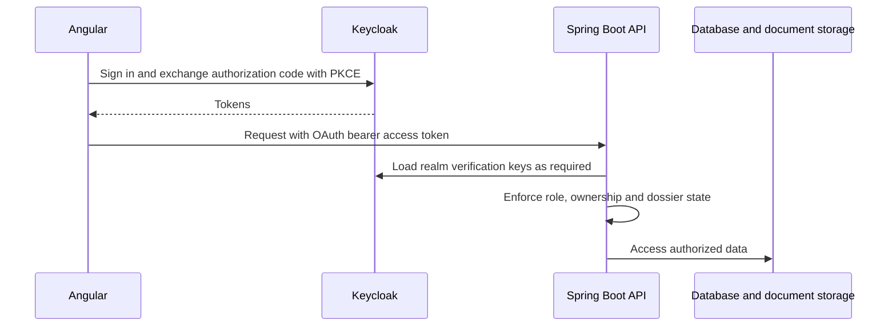

# Identity and access management

The Angular application uses a public OpenID Connect client named `etu-app` in the Keycloak realm `DISP`. The JavaScript adapter uses the authorization code flow with PKCE. It requests the `openid email` scopes, checks the Keycloak session and refreshes the access token while the user is active.

The Angular interceptor is scoped to the configured API origin. Spring Security uses a stateless bearer-token filter chain, verifies the token signature with the realm keys and maps `realm_access.roles` to authorities. The API controls which roles can read or manage the catalogue. Student endpoints also check the dossier owner, the state of the dossier and the association of linked records with their dossier. The Angular guard controls navigation. [Keycloak client](../dispense_app_ang/src/app/auth/keycloak.config.ts) · [Resource server](../src/main/java/org/isfce/pid/config/SecurityConfig.java) · [Dossier permissions](../src/main/java/org/isfce/pid/controller/DossierController.java)

The resource server validates timestamps, the configured issuer and the dedicated API audience after verifying the signature. The development configuration is for loopback and uses sample database records. CORS is limited to configured origins on API routes. The Compose demo imports fictional students and a client that adds the dedicated audience to access tokens. [Demo realm and deployment settings](../keycloak/README.md)

Uploaded documents use server-generated storage keys confined to the owning dossier's directory. Reference metadata remains separate, and the API omits internal absolute file paths. Legacy records without a storage key remain readable as metadata. Review files left by old records before reconciling storage. Only the application OS account should write to the upload root. Backups, file policy, quota, malware scanning and periodic reconciliation remain deployment controls.

## Verification

The workflow runs Gradle tests, the JAR build, the locked Angular installation, Angular tests and frontend compilation. Tests cover signed fixture tokens with the wrong issuer, a missing or unrelated audience, and expiry. API and filesystem tests verify document ownership and managed file handling. The workflow also imports the demo realm and checks its discovery metadata and verification keys. A browser sign-in and deployment TLS review remain separate checks. [CI workflow](../.github/workflows/ci.yml)
